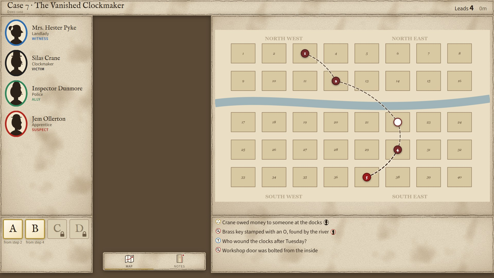
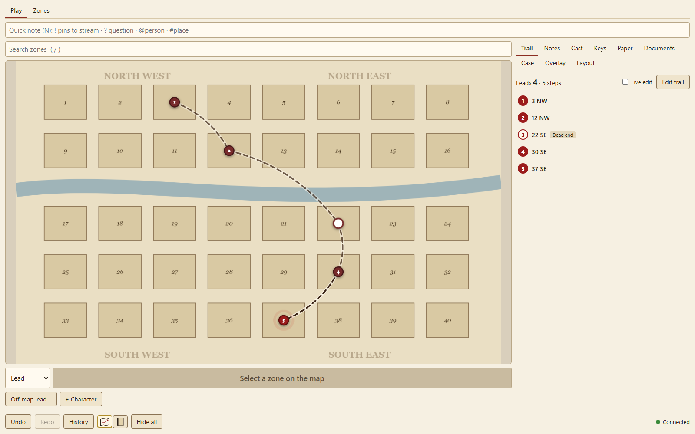
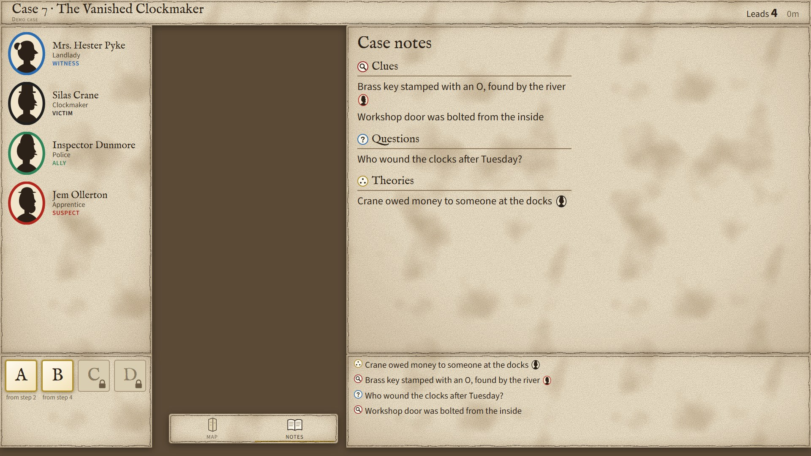

# Consulting Detective Stream Overlay

A local web app for streaming *Sherlock Holmes Consulting Detective*: a transparent overlay for OBS showing the map with your trail, the cast, letter keys, notes, the newspaper, directory and informants, plus a control panel to run it all live. The two stay in sync through a small server on your own computer.

**No game content is included.** The newspapers, directory, informants and map come from your own copy of the game: you put its PDFs in `data/` (see [SETUP.md](SETUP.md)). Nothing game-specific is bundled, downloaded or fetched.



*The overlay, shown here on a plain backdrop (it's transparent in OBS). Screenshots use an invented demo case and town, not the game's.*

| Control panel | Notes expanded on stream |
| --- | --- |
|  |  |

## Features

- **Map trail:** click a zone (or search "14 WC") to record each move; numbered pins and a path animate on stream. Zones are drawn once in the built-in zone editor and shared by every case.
- **Documents:** the newspapers, directory and informants rendered from your PDFs, searchable together, with highlights that follow you live on stream.
- **Cast, notes and letter keys:** portraits, `@person` and `#place` mentions, pinned notes, evidence cards, and keys unlocked as you go.
- **Built for live use:** everything syncs instantly, is undoable, and can be edited on the fly. A layout editor places every panel, and a panic switch hides it all.

## Requirements

- [Node.js](https://nodejs.org) 22 or newer
- OBS (or any app with a browser source), for streaming
- Your own copy of the game, for its PDFs

## Getting started

1. Download or clone this repository.
2. Put the game's PDFs in `data/artifacts/` ([SETUP.md](SETUP.md) has the details).
3. Run `start.bat` (Windows) or `./start.sh` (Mac and Linux). The first run installs and builds; the control panel then opens at `http://localhost:7777/control`.
4. In OBS, add a Browser Source with the URL `http://localhost:7777/overlay`, 1920 × 1080.

[quick_guide.md](quick_guide.md) is a one-page reference for streaming; [GUIDE.md](GUIDE.md) covers everything, including hotkeys.

## Your data

Everything that isn't code lives in `data/`: the game's PDFs, map images and zones, cases, portraits, icons, fonts, layouts and theme. Git ignores it, so it's never published and updating the code never touches it. [data/README.md](data/README.md) lists what goes where. Set `DATA_DIR` to keep it somewhere else.

## Development

```sh
npm install
npm run dev        # server with live reload on http://localhost:7777
npm test           # unit tests (Vitest)
npm run check      # type-check (TypeScript and svelte-check)
npm run test:e2e   # end-to-end smoke test (Playwright, Microsoft Edge)
npm run screenshots  # regenerate the README's screenshots (docs/screenshots/)
```

TypeScript throughout: Svelte 5 pages, a Fastify server, and one shared reducer (in `shared/`) used by the server and both pages. Every change is an action, so it syncs, saves and can be undone. [DESIGN.md](DESIGN.md) is the full design.

```text
server/   Fastify server: state, saving and undo, uploads, PDF indexing
shared/   types, actions and the reducer, shared by server and pages
web/      the overlay and control panel (Svelte)
data/     your files (git-ignored)
```

## License

The code is released under the [MIT License](LICENSE). It covers this repository's code only, not the game or any of its materials.

## Disclaimer

This is an unofficial fan project, not affiliated with or endorsed by the publishers of *Sherlock Holmes Consulting Detective*. The game and its materials belong to their respective owners.
